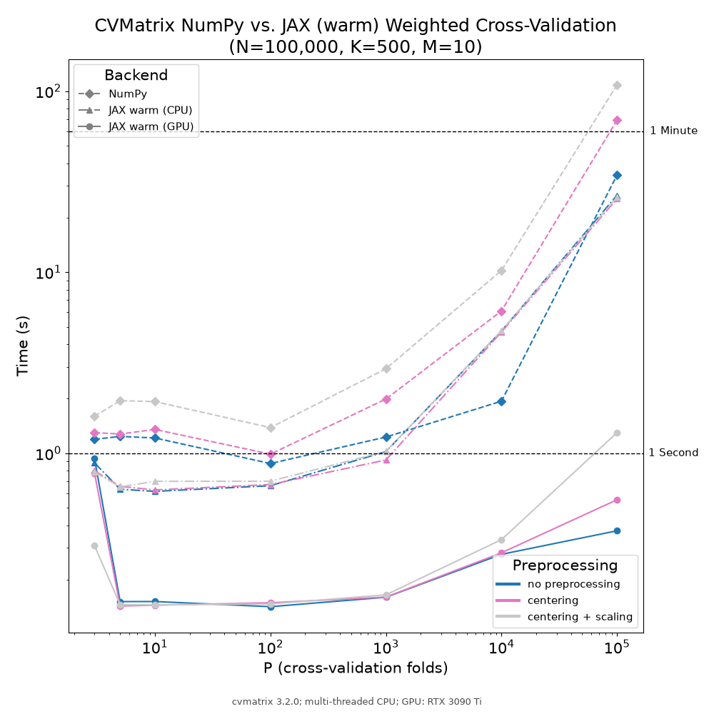
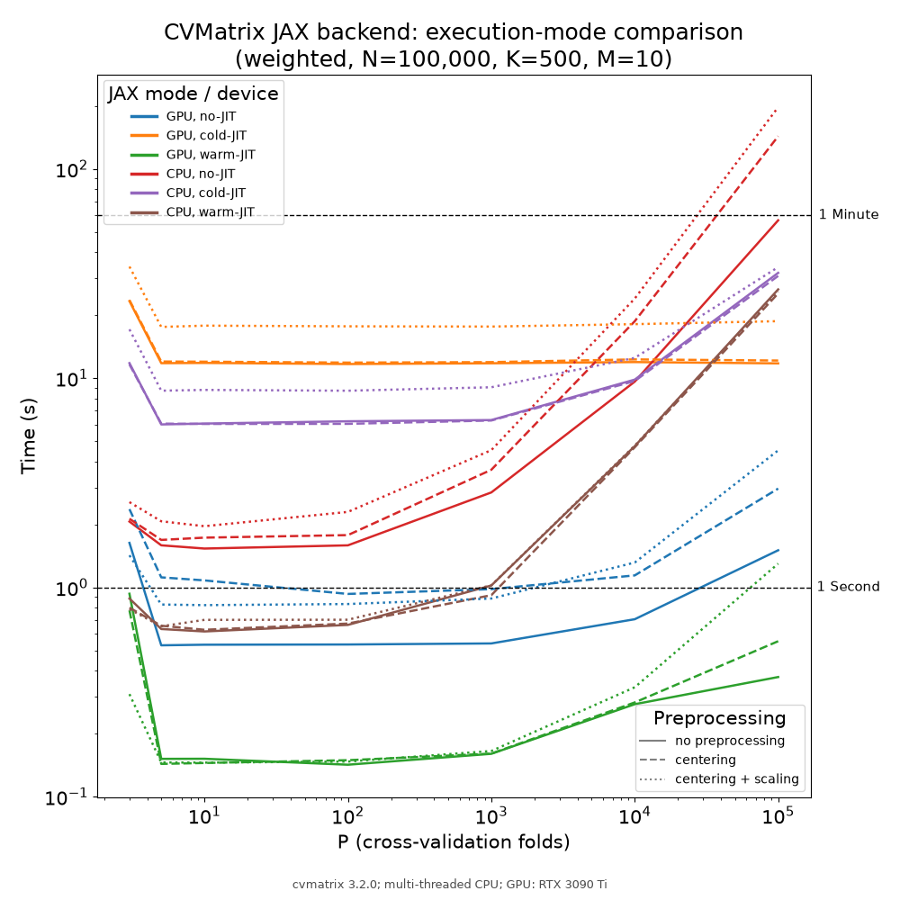

# CVMatrix

[](https://pypi.python.org/pypi/cvmatrix/)

[](https://pypi.python.org/pypi/cvmatrix/)

[](https://pepy.tech/project/cvmatrix/)

[](https://pypi.python.org/pypi/cvmatrix/)

[](https://pypi.python.org/pypi/cvmatrix/)

[](https://cvmatrix.readthedocs.io/en/latest/?badge=latest)

[](https://www.codefactor.io/repository/github/sm00thix/cvmatrix/overview/main)

[](https://github.com/Sm00thix/CVMatrix/actions/workflows/test_workflow.yml)

[](https://coveralls.io/github/sm00thix/cvmatrix?branch=main)

[](https://github.com/Sm00thix/CVMatrix/actions/workflows/package_workflow.yml)

The [`cvmatrix`](https://pypi.org/project/cvmatrix/) package implements the fast cross-validation algorithms by Engstrøm and Jensen [[1]](#references) for computation of training set $\mathbf{X}^{\mathbf{T}}\mathbf{X}$ and $\mathbf{X}^{\mathbf{T}}\mathbf{Y}$ in a cross-validation setting. In addition to correctly handling arbitrary row-wise pre-processing, the algorithms allow for and efficiently and correctly handle any combination of column-wise centering and scaling of `X` and `Y` based on training set statistical moments.

For an implementation of the fast cross-validation algorithms combined with Improved Kernel Partial Least Squares [[2]](#references), see the Python package [`ikpls`](https://pypi.org/project/ikpls/) by Engstrøm et al. [[3]](#references).

The `cvmatrix` software package now also features **weigthed matrix produts** $\mathbf{X}^{\mathbf{T}}\mathbf{W}\mathbf{Y}$ **without increasing time or space complexity compared to the unweighted case**. This is due to a generalization of the algorithms by Engstrøm and Jensen [[1]](#references). A new article formally describing the generalization is to be announced.

## Citation
- If you use the `cvmatrix` software package for your work, please cite  [this Journal of Chemometrics article](https://analyticalsciencejournals.onlinelibrary.wiley.com/doi/full/10.1002/cem.70008).
- If you use the sample weighted option, please also cite [this PhD thesis](https://arxiv.org/abs/2510.13452).

## Installation

- Install the package for Python3 using the following command:
    ```shell
    pip3 install cvmatrix
    ```

- Now you can import the class implementing all the algorithms with:
    ```python
    from cvmatrix import CVMatrix
    ```

- You can also install the optional JAX dependency to enable the JAX backend of
  `CVMatrix`:
    ```shell
    pip3 install "cvmatrix[jax]"
    ```
- Now, you can select the JAX backend by passing `backend="jax"` to the constructor:
    ```python
    from cvmatrix import CVMatrix

    cvm = CVMatrix(
        center_X=True, center_Y=True, scale_X=True, scale_Y=True, backend="jax"
    )
    ```
  With `backend="jax"`, the per-fold training-matrix computations (`training_XTX`,
  `training_XTY`, `training_XTX_XTY`, and `training_statistics`) use `jax.numpy` and can
  be traced by `jax.jit` and batched over folds with `jax.vmap` on CPUs, GPUs, and TPUs.
  The default `backend="numpy"` is unchanged and remains byte-for-byte identical to
  previous releases.

### Prerequisites for the JAX backend

The JAX backend supports running on CPU, GPU, and TPU.

- To enable NVIDIA GPU execution, install JAX and CUDA with:
    ```shell
    pip3 install -U "jax[cuda13]"
    ```

- To enable Google Cloud TPU execution, install JAX with:
    ```shell
    pip3 install -U "jax[tpu]"
    ```

These are typical installation instructions that will be what most users are looking for.
For customized installations, follow the instructions from the [JAX Installation
Guide](https://jax.readthedocs.io/en/latest/installation.html).

To ensure that the JAX backend uses float64, set the environment variable
```JAX_ENABLE_X64=True``` as per the [Common
Gotchas](https://docs.jax.dev/en/latest/notebooks/Common_Gotchas_in_JAX.html#double-64bit-precision).
`CVMatrix` also enables this automatically when constructed with `backend="jax"` and a
64-bit `dtype` (the default). Alternatively, float64 can be enabled with the following
function call:
```python
import jax
jax.config.update("jax_enable_x64", True)
```

### Validating weights and folds before tracing

Under `jax.jit` and `jax.vmap`, traced values are unknown until the compiled computation
runs, so `CVMatrix` cannot raise for traced weights or, with weights, for traced fold
indices. Checking inside the computation would slow down every call, so `CVMatrix`
instead checks everything that is known while tracing (concrete weights and fold
indices, and the training-set size of every fold without weights) and leaves the rest
to `validate_folds`, which you call once on the concrete values before tracing. Without
it, invalid weights or folds silently give wrong or NaN results.

```python
import jax
import jax.numpy as jnp
import numpy as np
from cvmatrix import CVMatrix, Partitioner

jax.config.update("jax_enable_x64", True)  # Before tracing, for float64.

rng = np.random.default_rng(42)
X = rng.random((8, 100, 5))  # 8 datasets of 100 samples each.
Y = rng.random((8, 100, 2))
W = rng.random((8, 100))  # One weight vector per dataset.
p = Partitioner(np.arange(100) % 5)  # 5 equal-size folds, shared by all datasets.
val_indices = jnp.asarray(np.stack(list(p.folds_dict.values())))

# Check the concrete weights and folds on the host, before they are traced.
for weights in W:
    CVMatrix(backend="jax").validate_folds(p, 100, weights)

def per_dataset(x, y, w):
    cvm = CVMatrix(backend="jax")
    cvm.fit(x, y, w)  # `w` is traced here, so it cannot be checked.
    return jax.vmap(cvm.training_XTX_XTY)(val_indices)

(XTX, XTY), stats = jax.jit(jax.vmap(per_dataset))(X, Y, W)
```

## Quick Start

### Use the cvmatrix package for fast computation of training set kernel matrices

> ```python
> import numpy as np
> from cvmatrix import CVMatrix
> from cvmatrix import Partitioner
>
> N = 100  # Number of samples.
> K = 50  # Number of features.
> M = 10  # Number of targets.
>
> X = np.random.uniform(size=(N, K)) # Random X data
> Y = np.random.uniform(size=(N, M)) # Random Y data
> folds = np.arange(100) % 5 # 5-fold cross-validation
>
> # Weights must be non-negative. If centering or scaling is used, the sum of weights
> # for any training partition must be greater than zero. If scaling is used, the
> # number of non-negative weights for any training partition must be greater than
> # the ddof provided in the constructor.
> weights = np.random.uniform(size=(N,)) + 0.1
>
> # Instantiate CVMatrix
> cvm = CVMatrix(
>     center_X=True, # Cemter around the weighted mean of X.
>     center_Y=True, # Cemter around the weighted mean of Y.
>     scale_X=True, # Scale by the weighted standard deviation of X.
>     scale_Y=True, # Scale by the weighted standard deviation of Y.
> )
> # Fit on X, Y, and weights
> cvm.fit(X=X, Y=Y, weights=weights)
>
> # Instantiate Partitioner
> p = Partitioner(folds=folds)
>
> # Compute training set XTWX and/or XTWY for each fold
> for fold in p.folds_dict:
>     val_indices = p.get_validation_indices(fold)
>     # Get both XTWX, XTWY, and weighted statistics
>     result = cvm.training_XTX_XTY(val_indices)
>     (training_XTWX, training_XTWY) = result[0]
>     (training_X_mean, training_X_std, training_Y_mean, training_Y_std) = result[1]
>     
>     # Get only XTWX and weighted statistics for X.
>     # Weighted statistics for Y are returned as None as they are not computed when
>     # only XTWX is requested.
>     result = cvm.training_XTX(val_indices)
>     training_XTWX = result[0]
>     (training_X_mean, training_X_std, training_Y_mean, training_Y_std) = result[1]
>     
>     # Get only XTWY and weighted statistics
>     result = cvm.training_XTY(val_indices)
>     training_XTWY = result[0]
>     (training_X_mean, training_X_std, training_Y_mean, training_Y_std) = result[1]

### Examples
In [examples](https://github.com/Sm00thix/CVMatrix/tree/main/examples), you will find:

- [Compute training matrices with CVMatrix](https://github.com/Sm00thix/CVMatrix/tree/main/examples/training_matrices.py)
- [Compute training matrices with the JAX backend, batched over folds with `jax.vmap` on CPU/GPU/TPU](https://github.com/Sm00thix/CVMatrix/tree/main/examples/training_matrices_jax.py)

## Benchmarks

In [benchmarks](https://github.com/Sm00thix/CVMatrix/tree/main/benchmarks), we have benchmarked cross-validation of the fast algorithms in [`cvmatrix`](https://pypi.org/project/cvmatrix/) against the baseline algorithms implemented in [NaiveCVMatrix](https://github.com/Sm00thix/CVMatrix/tree/main/tests/naive_cvmatrix.py).

<p align=center>
    
   <br>
   <em> <strong>Left:</strong> Benchmarking cross-validation with the CVMatrix implementation versus the baseline implementation using three common combinations of (column-wise) centering and scaling. <strong>Right:</strong> Benchmarking cross-validation with the CVMatrix implementation for all possible combinations of (column-wise) centering and scaling. Here, most of the graphs lie on top of eachother. In general, no preprocessing is faster than centering which, in turn, is faster than scaling. </em>
</p>

The figures below add the optional JAX backend to the comparison (NumPy vs. JAX, and the JAX execution modes). They are measured **multi-threaded** (no thread limit; GPU on an NVIDIA RTX 3090 Ti) and **exclude `NaiveCVMatrix`**:

<p align=center>
    
   <br>
   <em> <strong>Left:</strong> CVMatrix with the NumPy backend versus the JAX backend (warm, JIT-compiled <code>jax.vmap</code> over folds) on CPU and GPU, for the three common preprocessing combinations. <strong>Right:</strong> The JAX backend under no-JIT (eager <code>vmap</code>), cold-JIT (compilation + run) and warm-JIT (run only), on CPU and GPU. JIT compilation is a large fixed cost: on the GPU, no-JIT beats cold-JIT for a single run, whereas on the CPU, JIT (even cold) is far faster than eager <code>vmap</code> at a large number of folds. </em>
</p>

## Contribute

To contribute, please read the [Contribution
Guidelines](https://github.com/Sm00thix/CVMatrix/blob/main/CONTRIBUTING.md).

## References

1. [Engstrøm, O.-C. G. and Jensen, M. H. (2025). Fast partition-based cross-validation with centering and scaling for $\mathbf{X}^\mathbf{T}\mathbf{X}$ and $\mathbf{X}^\mathbf{T}\mathbf{Y}$. *Journal of Chemometrics*, 39(3).](https://doi.org/10.1002/cem.70008)
2. [Dayal, B. S. and MacGregor, J. F. (1997). Improved PLS algorithms. *Journal of Chemometrics*, 11(1), 73-85.](https://doi.org/10.1002/(SICI)1099-128X(199701)11:1%3C73::AID-CEM435%3E3.0.CO;2-%23?)
3. [Engstrøm, O.-C. G. and Dreier, E. S. and Jespersen, B. M. and Pedersen, K. S. (2024). IKPLS: Improved Kernel Partial Least Squares and Fast Cross-Validation Algorithms for Python with CPU and GPU Implementations Using NumPy and JAX. *Journal of Open Source Software*, 9(99).](https://doi.org/10.21105/joss.06533)

## Funding
- Up until May 31st 2025, this work has been carried out as part of an industrial Ph. D. project receiving funding from [FOSS Analytical A/S](https://www.fossanalytics.com/) and [The Innovation Fund Denmark](https://innovationsfonden.dk/en). Grant number 1044-00108B.
- From June 1st 2025 and onward, this work is sponsored by [FOSS Analytical A/S](https://www.fossanalytics.com/).
